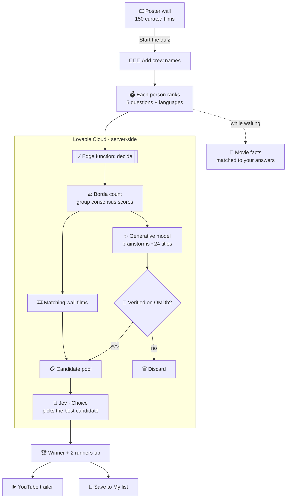
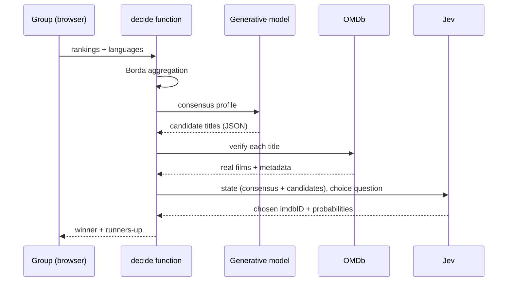

<div align="center">

# 🎬 WhatToWatch *Tonight*

### One film. Everyone agrees.

**Your group ranks five questions. A Borda count combines the votes. Jev picks the film.**

[**▶ Live demo: whattowatch-tonight.lovable.app**](https://whattowatch-tonight.lovable.app)


</div>

---

> *"My sister and I always had trouble deciding what to watch on movie nights. We'd scroll for hours, argue about genres, and eventually just give up or watch the same thing we always do. So, we thought: let's do this. Let's build something that actually helps you decide."* — **Tejas Govind**

## 🤔 The problem

Picking a film alone is easy. Picking one for **four people** means 40 minutes of scrolling, a veto war, and somebody's comfort rewatch. Recommendation engines answer *"what do **you** like?"* but nobody answers *"what will **all of us** be happy with?"*

## 💡 The solution

WhatToWatch Tonight is a **group decision engine** for movie night:

1. 🧑‍🤝‍🧑 **Add your crew**: everyone gets a turn.
2. 🗳️ **Each person ranks the answers** to five questions (mood, genre, era, and so on), and types the languages they're happy to watch.
3. ⚖️ **Code combines the rankings fairly** with a Borda count, so a person's last choice counts against an option.
4. 🔎 **Candidates are gathered** from a curated 150-film wall plus AI-suggested titles, each **verified on OMDb**.
5. 🧠 **Jev makes the final call**, choosing the one candidate that best fits the whole group's consensus.
6. 🍿 You get **a winner and two runners-up**, each with a trailer and a one-click save to your list.

## 🧠 How Jev fits in

[**Jev**](https://docs.typesafe.ai) is TypeSafe's *System One* model. It doesn't write text; it returns **typed decisions** (a choice from a set, with probabilities). That's exactly the right tool here:

| Step | Who does it | Why |
| --- | --- | --- |
| Aggregate everyone's rankings | **Code** (Borda count) | Fair, explainable, and deterministic |
| Brainstorm real films that fit | **Generative model** (`openai/gpt-6-astra`, JSON schema) | OMDb has no "discover" endpoint |
| Verify each title exists | **OMDb API** | No made-up movies |
| **Pick the one film** | **Jev** (`typesafe/jev-latest`, *Choice* over candidate IDs) | A fast, focused judgment, and it can only choose a film that's really on the list |

Because Jev picks from a list of **candidate IDs**, the result can never be a made-up film. The policy stays in code; Jev provides the common-sense judgment.

## 🗺️ Architecture



### Request lifecycle



## ✨ Features

- 🎞️ **Poster wall you can drag around**: 150 films, panning at 60fps on its own animation loop, with a pixel-bloom effect when you hover.
- 🗳️ **Ranked group quiz**: five questions, ranked answers, plus a free-text language field (*English, Telugu, French, Hindi…*).
- 🧠 **Jev-powered final pick**: typed decision, never a made-up title.
- 🌍 **Beyond the wall**: films from any country or language, all verified on OMDb.
- 💬 **Fact cards while you wait**: 200+ facts tagged by topic and matched to your answers, with zero AI cost.
- ⭐ **Ratings**: IMDb, Rotten Tomatoes, and Metacritic scores with vote counts.
- ▶️ **Trailers**: YouTube Data API, with a fallback when a video can't be embedded.
- 🔎 **⌘K search** across all of OMDb.
- 🔖 **My list**: saved in your browser between visits.

## 🧰 Tech stack

| Layer | Tech |
| --- | --- |
| Frontend | React 18, Vite, TypeScript, Tailwind CSS, shadcn/ui, Lenis smooth scroll |
| Backend | Lovable Cloud edge function (`decide`) |
| AI | TypeSafe **Jev** for decisions, `openai/gpt-6-astra` for brainstorming, both via the Lovable AI Gateway |
| Data | OMDb API, YouTube Data API v3 |
| Design | Instrument Serif, Geist, and Geist Mono on a warm near-black background with amber accents and film grain |

## 🚀 Run it locally

```sh
git clone <YOUR_GIT_URL>
cd <repo>
npm install
npm run dev   # http://localhost:8080
```

Set OMDb and YouTube keys in `src/lib/config.ts`. The AI key stays on the server, inside the backend function.

## 📁 Project map

```text
src/
  components/PosterCanvas.tsx   poster wall you can drag
  components/MovieNight.tsx     crew → quiz → deciding → result
  components/MovieSheet.tsx     details + ratings
  data/movies.json              150 curated films (mirrored in the function)
  data/facts.ts                 tagged facts for the loading screen
supabase/functions/decide/      Borda → brainstorm → OMDb → Jev
```

## 🛣️ What's next

- Join from your own phone with a room code
- Remember the group's past picks so the same film isn't chosen twice
- Filter by streaming service

---

<div align="center">

Built for movie nights everywhere · **WhatToWatch Tonight**

</div>
